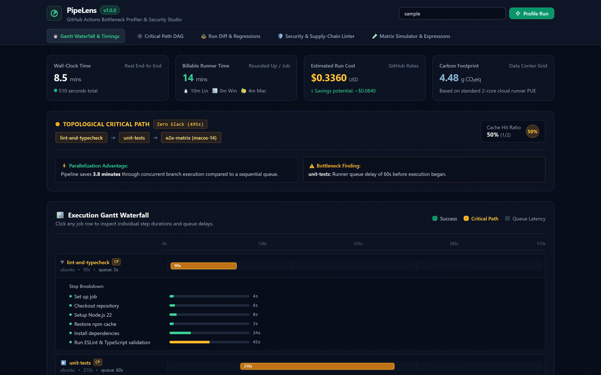
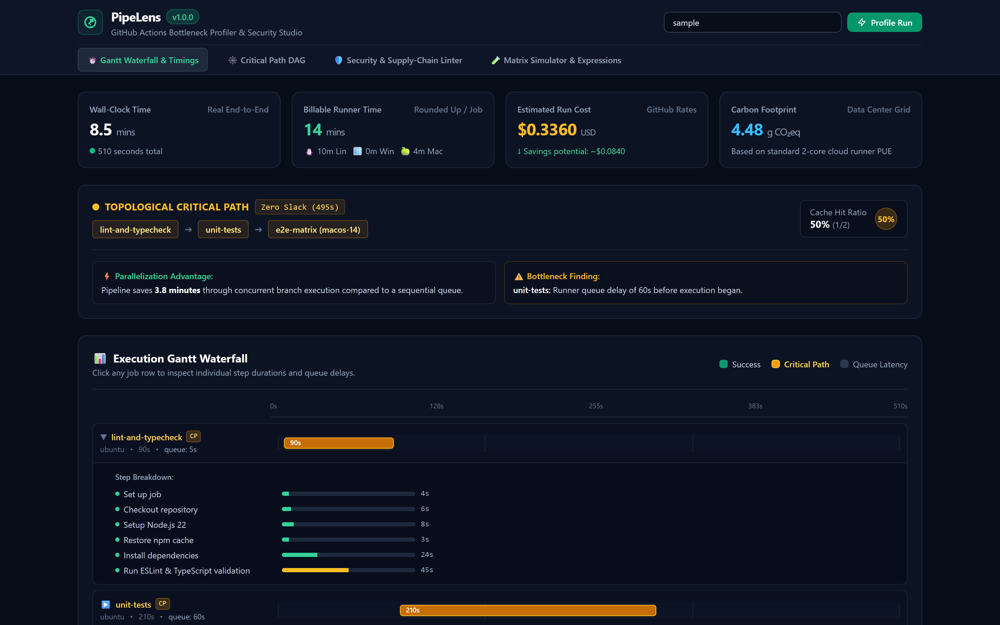
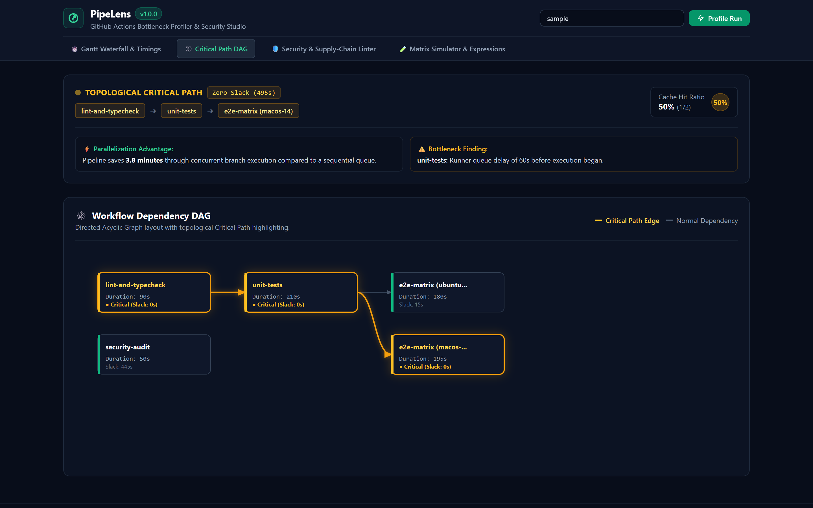
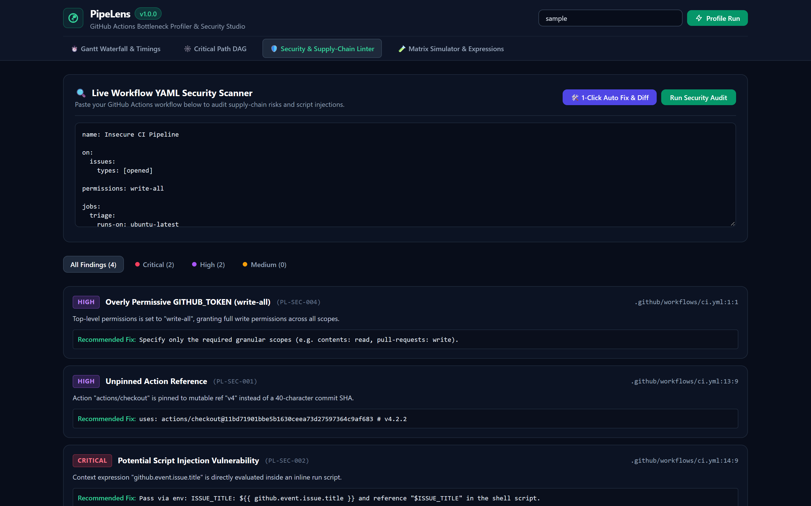
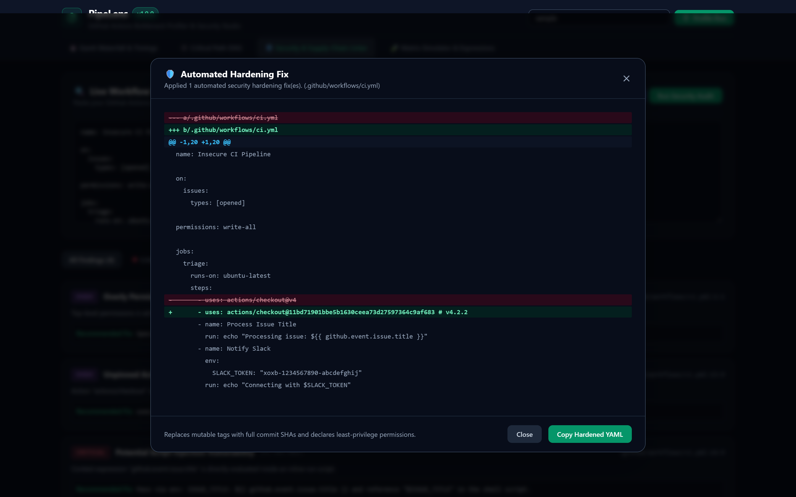

# PipeLens

GitHub Actions CI/CD bottleneck profiler, critical path DAG analyzer, supply-chain security linter, and local matrix simulator.



---

## Overview

PipeLens profiles GitHub Actions workflows to identify duration bottlenecks, model runner costs, detect broken caches, and audit supply-chain security risks.

- **Historical CI Gantt Waterfall**: Pulls job and step telemetry from the GitHub REST API to render visual execution timelines.
- **Critical Path DAG Computation**: Calculates topological float slack and identifies the critical chain of dependent jobs determining pipeline wall-clock time.
- **Cache Diagnostics**: Measures cache hit ratios and calculates wasted runner minutes caused by cache misses.
- **Supply-Chain Security Linter**: Detects mutable action tags, direct script injection sinks in `run:` scripts, wildcard `GITHUB_TOKEN` permissions, and hardcoded secrets.
- **Automated Hardening Fixer**: Rewrites workflows with immutable 40-character commit SHAs and least-privilege permission blocks.
- **Matrix Simulator & Expression Evaluator**: Evaluates Cartesian matrix expansions (`include`/`exclude`) and parses `${{ ... }}` expressions locally.
- **Interactive Web Studio & CLI**: Provides a local web dashboard alongside automated CI gating (`pipelens audit --fail-on-sec`).

---

## Visual Studio

| Gantt Timeline Waterfall | Topological Critical Path DAG |
| :---: | :---: |
|  |  |

| Security Linter & Findings | Automated Hardening Diff |
| :---: | :---: |
|  |  |

---

## Installation

```bash
# Global CLI installation
npm install -g pipelens

# Or execute directly via npx
npx pipelens --help
```

---

## CLI Usage

### 1. Audit Workflows for Security Vulnerabilities

Scan `.github/workflows/` for unpinned actions, script injection sinks, and wildcard permissions:

```bash
# Audit local workflow directory
pipelens audit .github/workflows/

# Enforce gating in CI (exit code 1 on critical/high findings)
pipelens audit .github/workflows/ --fail-on-sec

# Export findings as SARIF for GitHub Code Scanning
pipelens audit .github/workflows/ --format sarif -o results.sarif

# Export findings as Markdown for GITHUB_STEP_SUMMARY
pipelens audit .github/workflows/ --format markdown
```

### 2. Profile Historical Workflow Runs

Analyze completed runs to compute the critical path and runner costs:

```bash
# Profile built-in sample telemetry (offline demo)
pipelens profile sample

# Profile a public GitHub repository
pipelens profile octocat/Hello-World

# Profile specific run with GitHub authentication token
pipelens profile my-org/my-repo 89410294 --token ghp_yourToken
```

Example terminal output:

```text
⚡ PipeLens CI/CD Critical Path & Bottleneck Profiler

Workflow: CI / Test & Build Suite #142
Run URL:   https://github.com/alexandrmotologa/pipelens/actions/runs/89410294
Status:    ✓ Succeeded
Duration:  510s (Total wall-clock: 8.5m)

🎯 Critical Path DAG:
  Path:     lint-and-typecheck ➔ unit-tests ➔ e2e-matrix (macos-14)
  Duration: 8.3 minutes (495s)
  Parallelization Gain: 3.8 minutes saved vs serial execution

💰 Runner Billing & Resource Impact:
  Total Billable Minutes: 14 mins
  Estimated Cost:         $0.3360 USD
  Estimated Carbon:       4.48 g CO2eq
  Optimization Potential: $0.0840 USD

📦 Cache Diagnostics:
  Hit Ratio:      50% (1 hits / 2 steps)
  Wasted Duration: 42s from cache misses

⚠️ Bottlenecks & Optimization Advice:
  • [MEDIUM] unit-tests: Runner queue delay of 60s before execution began.
    Recommendation: Check runner pool saturation or consider self-hosted runners.
  • [MEDIUM] e2e-matrix (macos-14): Job is on the critical path and ran for 195s.
    Recommendation: Decompose heavy test suites or utilize granular caching.
```

### 3. Simulate Matrix Expansion

Calculate job fan-out, runner operating systems, and estimated billing before pushing:

```bash
pipelens simulate .github/workflows/matrix_build.yml
```

### 4. Automatically Harden Workflows

Generate unified diffs and replace mutable tags with immutable commit SHAs:

```bash
# Preview changes without modifying files
pipelens fix .github/workflows/ --dry-run

# Apply fixes directly to disk
pipelens fix .github/workflows/
```

### 5. Launch the Web Studio

Start the interactive React 19 web dashboard:

```bash
pipelens serve --port 3840
# Open http://localhost:3840 in your browser
```

---

## REST API Reference

The local server exposes REST endpoints for integration:

| Method | Endpoint | Description |
| :--- | :--- | :--- |
| `GET` | `/api/health` | Service health status |
| `GET` | `/api/profile?repo=owner/repo&runId=123` | Ingests run telemetry and returns DAG and cost metrics |
| `POST` | `/api/lint` | Analyzes raw YAML for security vulnerabilities |
| `POST` | `/api/fix` | Generates unified diff and hardened YAML |
| `POST` | `/api/simulate` | Evaluates matrix expansion and context expressions |

---

## Documentation

- [RULES.md](docs/RULES.md): Detailed specification of diagnostic security rules (PL-SEC-001 through PL-SEC-005).
- [ARCHITECTURE.md](docs/ARCHITECTURE.md): Mathematical formulation of the Critical Path Method DAG and GitHub billing models.

---

## License

MIT © [Alexandr Motologa](https://github.com/alexandrmotologa)
